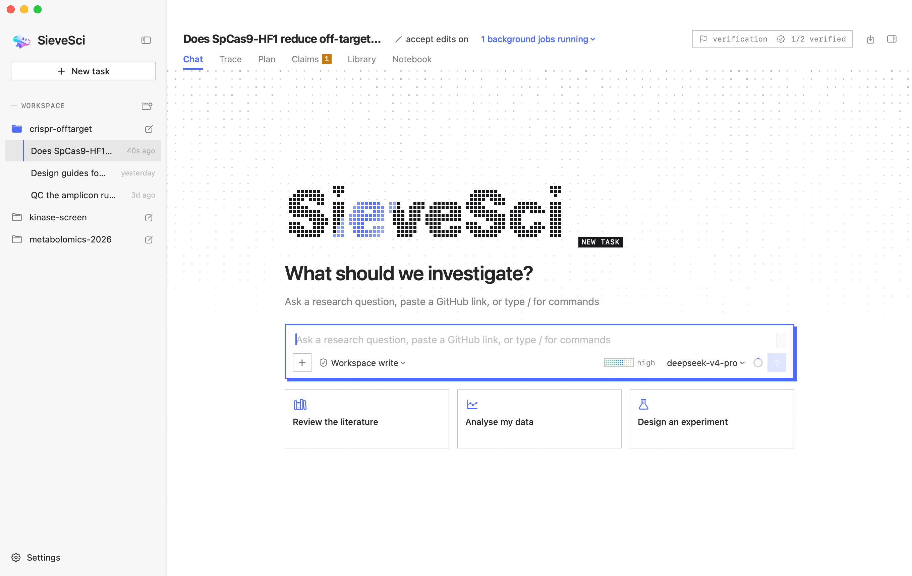
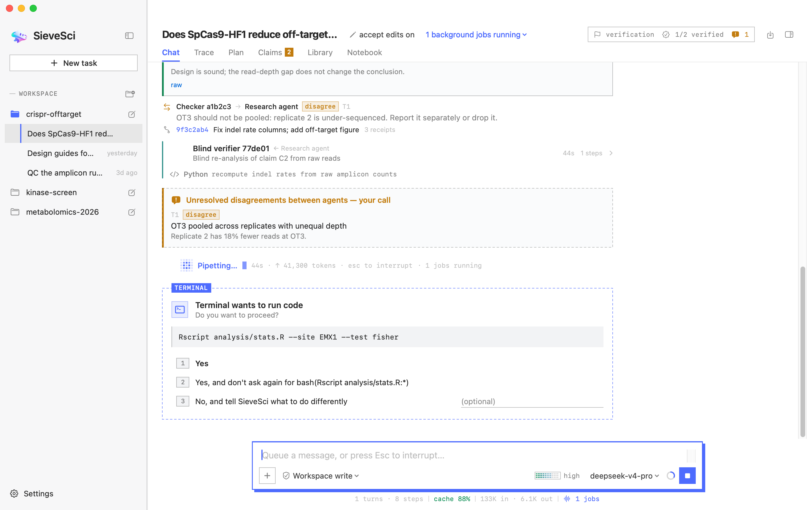
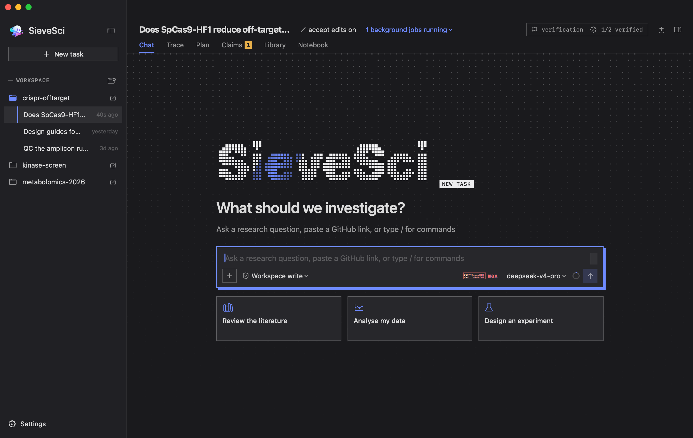
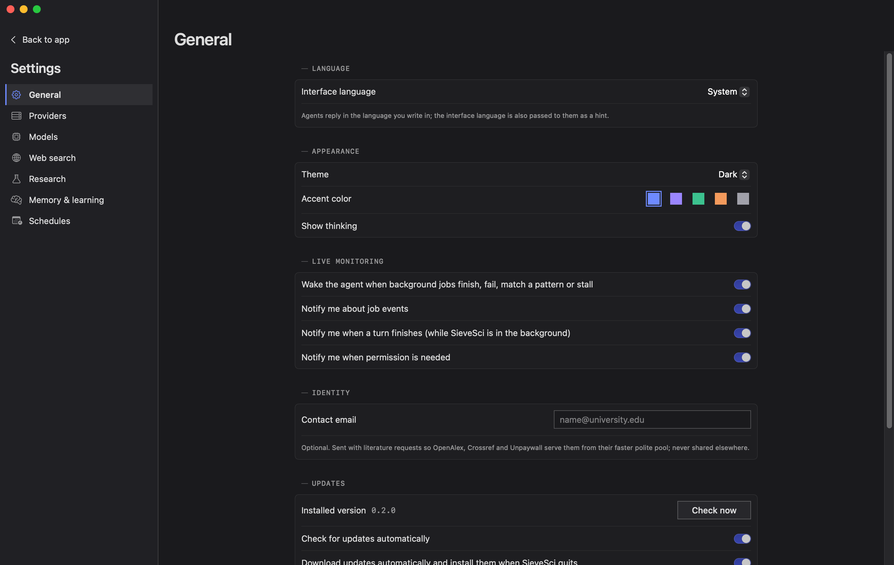

# SieveSci

<p align="center">
  
  
  
  <a href="https://github.com/Cetirzine/SieveSci/releases/latest"></a>
  <a href="https://github.com/Cetirzine/SieveSci/stargazers"></a>
  <a href="LICENSE.md"></a>
</p>

[简体中文](README.md)

A native macOS research agent for biology and chemistry, built with SwiftUI. It searches before it speaks, plans with checkpoints, writes and runs its own analysis code, and has every significant claim checked by independent agents. Everything it does is logged and traceable.

<p align="center"></p>

## Features

**Research workflow**

- Scope → background search (web and literature are both required before plans, claims or conclusions) → plan with hypotheses and soft checkpoints → execute → independent review → claims → write-up
- Plan mode: read-only research and planning until you approve the plan
- `/goal`: long-running objectives with automatic continuation rounds. A round never polls: running background jobs wake the agent when they report; a round that does no work or repeats the last one hands the goal back to you; 30 rounds by default (`--rounds N`). When the agent needs your decision it asks one concrete question through a structured field

**Independent oversight**

- A checker reviews checkpoints and suspicious output: hard-coded results, seed fishing, synthetic data, uncorrected multiple tests, unsupported numbers or citations
- A blind verifier re-implements every claimed finding from the raw data without seeing the agent's code
- Bounded deliberation: agents can question and rebut each other, but only with new evidence, without repetition and within a hard limit; points that do not settle are marked *contested* and shown to you
- No silent passes: a reviewer that declines or fails is retried once on another model, then the step is reported as unreviewed

**Literature**

- OpenAlex, Europe PMC, arXiv and Crossref search with citation counts; citation-graph traversal
- Open-access full text, a per-task library with BibTeX, citation verification including retractions, contradiction search
- `@cite key` comments link code to papers both ways

**Databases and chemical safety**

- One `bio_db` tool for UniProt, NCBI (Gene, PubMed, GEO, SRA, Nucleotide, Protein), RCSB PDB, AlphaFold, Ensembl, ChEMBL, Reactome and ClinicalTrials.gov; rate limits and outages are reported, never guessed around
- Chemicals screened against controlled-substance lists by structure (CAS, SMILES, InChIKey, parent compound); unscreenable structures are reported as unscreened
- Science connectors: one click to connect [ToolUniverse](https://github.com/mims-harvard/ToolUniverse) (an MCP server with 600+ scientific tools)

**Code and live monitoring**

- A sandboxed, Jupyter-style Python kernel per agent; bash and R through the shell; Seatbelt sandbox policies
- Long commands run as streaming jobs: you see output live, and the agent is notified when a job finishes, fails, matches a pattern or stalls instead of sleeping and polling; repeated error matches back off and are batched
- `job_watch` follows cluster or instrument logs

**Provenance**

- A hash-chained audit log, evidence receipts on every tool result, an automatic lab notebook
- A private git history of every change, linked both ways to the audit log; `/trace r12` shows a receipt's chain from code to output hash, files and commit
- Reports with receipt footnotes and a provenance appendix (Markdown, DOCX, PDF); executed Python exports as a Jupyter notebook

**Built-in research skills**

Literature review, deep research, systematic review and meta-analysis (PRISMA), novelty check, hypothesis tournament (pairwise ranking plus reflection, evolution and meta-review, after Google's AI co-scientist), virtual lab meeting (a PI convenes specialist agents with a scientific critic, after Stanford's Virtual Lab), experiment-design rounds, multi-trajectory analysis, figure review, paper write-up, chemical safety, Biomni tool search. The K-Dense scientific skill packs (≈180 skills) install in one step, each with its own Python environment.

**Models**

- Claude, OpenAI, Gemini, DeepSeek, GLM, OpenRouter, CloseAI and other relays, with native protocols and per-vendor prompt-cache optimisation
- Subscription plans through the official Claude Code, Codex, Antigravity and Gemini CLIs (driven in their official headless modes; OAuth tokens are never touched)
- Per-role model assignment (by benchmark, same for all, or custom); plan quota and balance display; context ring
- Capability detection from catalog rules, models.dev, the provider's own listing, and what the model showed in use: a model the catalogs call text-only gets an image once, and a refusal is remembered and falls back to the vision helper
- A stepped reasoning-effort slider in the composer, applied from the next model call

**Conversations and memory**

- Conversation context menu: rename, copy conversation ID, copy as Markdown, export Markdown, reference in the open conversation, fork, show in Finder, delete (to the Trash)
- Cross-conversation reading: `@task:<id>` in a message attaches another conversation's digest; `session_read` reads one by id, prefix or title; `session_search` searches all past conversations
- Cross-conversation memory: a new session's first turn carries an index of the workspace's other conversations (title and latest conclusion)
- Long-term memory and lessons per role (after Hermes Agent): when a store is full its oldest entries move to a searchable archive instead of the write failing; every change cites receipts and is independently reviewed
- Governed self-improvement: agents propose new or patched skills, screened and reviewed before they take effect
- Context management: old tool outputs give way to receipt pointers first (after OpenCode's prune), summarization only when that is not enough; repeat-call reminders

**Needs you (after dsh-superagent)**

- Every task has one stage: needs your answer, plan to approve, blocked, working, waiting for jobs, idle (first matching row wins)
- The sidebar's "Needs you" list gathers every task that waits for you across workspaces; only entering such a stage raises a notification
- An interrupted turn resumes with a note to check what already happened before repeating downloads, submissions or messages

**Extensions**

Skills (each with its own Python environment, built after your approval), MCP servers, hooks, slash commands, custom commands, scheduled runs (macOS LaunchAgents, e.g. a daily literature watch), project memory files (SIEVESCI.md / AGENTS.md / CLAUDE.md). The `sievesci` command line runs the same agent headless (scripts, scheduled jobs, SSH).

**Updates**

SieveSci checks GitHub Releases at launch and daily. A new release's disk image downloads in the background, is checked against the SHA-256 GitHub publishes and its code signature, and the sidebar offers "Restart to update"; otherwise it installs when you quit. "Check for Updates…" in the app menu or Settings → General checks by hand; both automatic steps can be turned off.

Interface languages: English · 简体中文 · 正體中文 · Русский · Español · Français.

## Interface

<p align="center"></p>

- The design language is a *specimen sheet*: square corners and 1 px rules, monospaced labels and readouts, one accent colour. Lines carry meaning: a **solid frame** is settled (verified, approved, your own words), a **dashed frame** is provisional (proposed by an agent, waiting for review or your decision); inverted monospaced tabs name the agent or tool a block came from
- A new task is a blank page: the dot-matrix wordmark sifts into place, the composer sits in the middle, with three starting points below
- While an agent works, a small dot grid ripples beside it like an instrument lamp; the primary buttons and the composer have heavy frames and hard shadows that they press into
- Reasoning effort is a dot-matrix gauge: the higher the level, the faster it flows; at the top level it turns red and glitches
- Buttons that belong together are equal width; light and dark appearance; Reduce Motion is respected

The full design language is in [docs/DESIGN_LANGUAGE.md](docs/DESIGN_LANGUAGE.md).

<p align="center">
  
  
</p>

## Build

Requires macOS 14+ and Swift 6 (Xcode 16 or later; Command Line Tools alone also work).

```bash
./scripts/bundle-app.sh
```

This builds `dist/SieveSci.app`, `dist/SieveSci.app.zip` and `dist/SieveSci-<version>.dmg` (release). With Command Line Tools only, the script picks an SDK that can build SwiftUI macros.

During development:

```bash
swift build --product SieveSci
swift test
```

The app is ad-hoc signed, not notarized. If macOS refuses to open a downloaded copy:

```bash
xattr -dr com.apple.quarantine SieveSci.app
```

## Command line

```bash
sievesci --workspace ~/project --provider deepseek -p "Summarise recent work on X"
sievesci --workspace ~/project                     # interactive
sievesci eval oversight --deterministic-only       # score oversight on the planted-error corpus
sievesci eval verifier --checker deepseek          # score the blind verifier on claims with known truth
```

API keys are read from the macOS Keychain (app) or environment variables (CLI), e.g. `ANTHROPIC_API_KEY`, `OPENAI_API_KEY`, `GEMINI_API_KEY`, `DEEPSEEK_API_KEY`, `ZHIPU_API_KEY`, `OPENALEX_API_KEY`, `BRAVE_API_KEY`.

## Layout

```
Sources/
  SieveSciCore/        UI-free core (also builds and tests on Linux)
    Agent/             agent loop, workbench, goals, task stages, slash commands, permissions, jobs
    LLM/               providers, model discovery and capabilities, prompt caching, quotas
    Research/          research protocol, oversight, deliberation, integrity, Bradley–Terry ranking
    Literature/        literature search, library, web search, citation checks
    Tools/             built-in tools, databases, Python kernel, sandbox
    Memory/            long-term memory, lessons, governed self-improvement
    Provenance/        audit log, shadow git, lab notebook, traces
    Extensions/        skills, MCP, hooks, science connectors
    Resources/         bundled research skills, eval corpora, catalogs
    Localization/      six interface languages
  SieveSciApp/         SwiftUI app
  sievesci-cli/        command line
Tests/                 unit tests
docs/                  capability matrix, design language
scripts/               bundling and corpus scripts
```

## Data locations

- A workspace's task records: `<workspace>/.sievesci/tasks/<task id>/` (conversation, audit log, lab notebook, outputs)
- App configuration: `~/Library/Application Support/SieveSci/config.json` (secrets live in the Keychain, not here)
- Long-term memory and skills: `~/.sievesci/` (memory, learned-skills, skill-packs, catalog, mcp.json)
- Logs: `~/Library/Logs/SieveSci`

## License

SieveSci is available under the [PolyForm Strict License 1.0.0](LICENSE.md): noncommercial use only; no distribution (including redistribution or reposting builds); no modifications or derivative works. Third-party material in the repository keeps its own license, see [THIRD_PARTY_NOTICES.md](THIRD_PARTY_NOTICES.md).

## Acknowledgements

What comes from which project is in [docs/CAPABILITY_MATRIX.md](docs/CAPABILITY_MATRIX.md). Main references:

- Research agents: [Biomni](https://github.com/snap-stanford/Biomni), [Robin](https://github.com/Future-House/robin), [PaperQA2](https://github.com/Future-House/paper-qa), [AI Scientist](https://github.com/SakanaAI/AI-Scientist), [Agent Laboratory](https://github.com/SamuelSchmidgall/AgentLaboratory), [ChemCrow](https://github.com/ur-whitelab/chemcrow-public), [STORM](https://github.com/stanford-oval/storm), [ToolUniverse](https://github.com/mims-harvard/ToolUniverse), Stanford Virtual Lab, Google AI co-scientist
- Coding agents: [Claude Code](https://github.com/anthropics/claude-code), [Codex](https://github.com/openai/codex), [OpenCode](https://github.com/anomalyco/opencode), [DeepSeek Harness](https://github.com/deepseek-ai/deepseek-harness), [dsh-superagent](https://github.com/deepseek-ai/dsh-superagent-prototype), [ZCode](https://github.com/zai-org/ZCode), [Reasonix](https://github.com/esengine/DeepSeek-Reasonix), [Hermes Agent](https://github.com/NousResearch/hermes-agent), [Kimi Code](https://github.com/MoonshotAI/kimi-code), [Gemini CLI](https://github.com/google-gemini/gemini-cli)
- Skills: [K-Dense AI](https://github.com/K-Dense-AI)
- Dependencies: [MCP Swift SDK](https://github.com/modelcontextprotocol/swift-sdk), [swift-markdown-ui](https://github.com/gonzalezreal/swift-markdown-ui), [SwiftMath](https://github.com/mgriebling/SwiftMath), [KeychainAccess](https://github.com/kishikawakatsumi/KeychainAccess), [Yams](https://github.com/jpsim/Yams), [EventSource](https://github.com/mattt/EventSource), [swift-crypto](https://github.com/apple/swift-crypto)

## Star History

<a href="https://star-history.com/#Cetirzine/SieveSci&Date">
  <picture>
    <source media="(prefers-color-scheme: dark)" srcset="https://api.star-history.com/svg?repos=Cetirzine/SieveSci&type=Date&theme=dark">
    
  </picture>
</a>

Independently developed by 王鹤年, 2026. Plans, analyses and conclusions from SieveSci are for researchers to judge and verify; it does not give medical, safety or legal advice.
