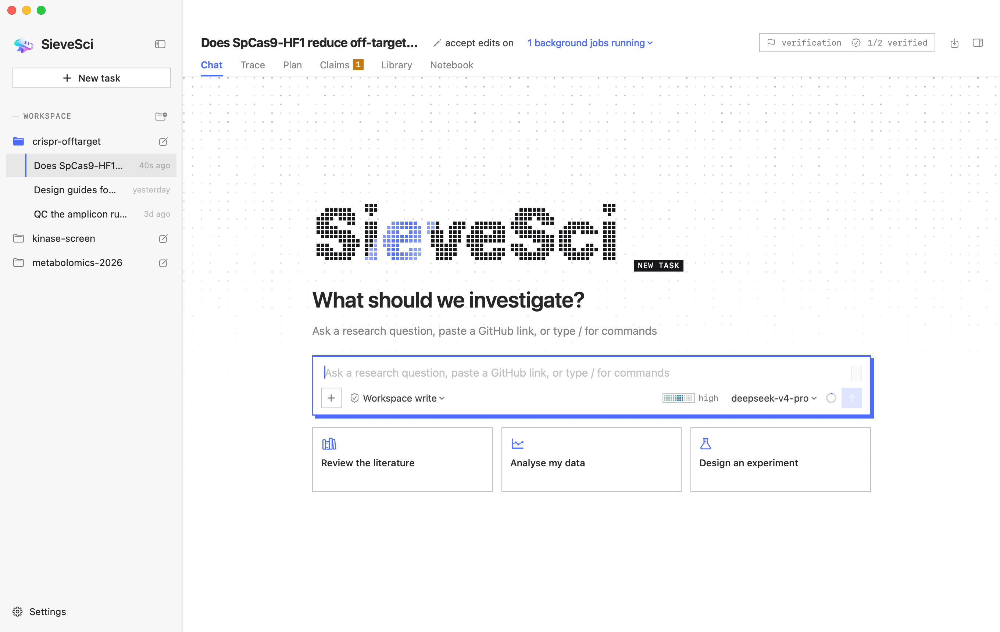
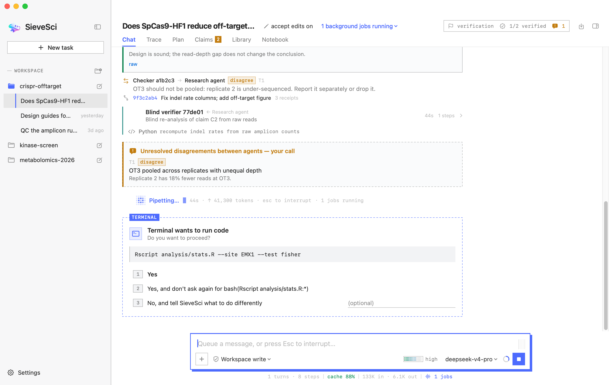
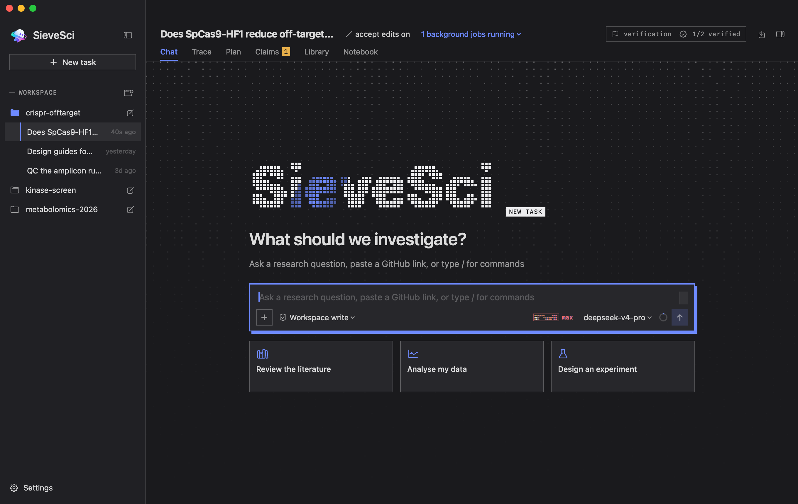
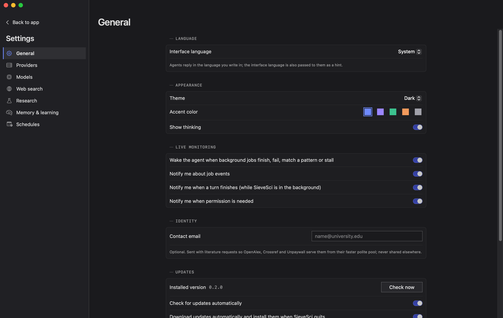

# SieveSci

<p align="center">
  
  
  
  <a href="https://github.com/Cetirzine/SieveSci/releases/latest"></a>
  <a href="https://github.com/Cetirzine/SieveSci/stargazers"></a>
  <a href="LICENSE.md"></a>
</p>

[English](README.en.md)

面向生物与化学研究的 macOS 原生科研智能体，SwiftUI 实现。先检索再发言，带检查点地做计划，自己写代码跑分析；每一条重要结论都由独立的智能体复核，所做的一切都有记录、可追溯。

<p align="center"></p>

## 特点

**研究流程**

- 界定问题 → 背景检索（网页与文献两路都必须完成，才允许做计划、提结论）→ 带假设与软检查点的计划 → 执行 → 独立审查 → 结论登记 → 撰写报告
- 计划模式：只读地调研与规划，批准计划后再执行
- `/goal` 长目标：自动连续推进多轮；有后台作业时等作业结果而不空转，某一轮没有进展或重复上一轮就交还给你，默认最多 30 轮（`--rounds N` 可改）；需要你决定时，模型用结构化的方式提一个具体问题

**独立监督**

- 检查者（checker）审查检查点与可疑输出：硬编码结果、反复换随机种子、合成数据、未校正的多重检验、没有依据的数字或引用
- 盲法验证者（verifier）只拿原始数据、看不到智能体的代码，独立重做每一条声称的发现
- 有限的辩论：智能体之间可以质疑和反驳，但必须提出新证据、不得重复、有次数上限；谈不拢的标为“有争议”交给你
- 不会默认放行：审查者拒绝或失败时换一个模型重试一次，仍失败就明确标记为“未审查”
- 计划审查与结论验证全程留痕，报告中注明哪些结论已验证、哪些仍在验证

**文献**

- OpenAlex、Europe PMC、arXiv、Crossref 检索，带引用数；沿引用图谱查参考文献与施引文献
- 开放获取全文、按任务建立的文献库与 BibTeX；引用核验（含撤稿与关注声明）；反向证据检索
- 代码中的 `@cite key` 注释把代码与论文双向关联

**数据库与化学安全**

- 一个 `bio_db` 工具接入 UniProt、NCBI（Gene、PubMed、GEO、SRA、Nucleotide、Protein）、RCSB PDB、AlphaFold、Ensembl、ChEMBL、Reactome、ClinicalTrials.gov；限流与故障时如实报告，不臆测
- 化学品按结构比对管制物质清单（CAS / SMILES / InChIKey / 母体化合物），无法筛查的明确标为未筛查
- 科研连接器：一键接入 [ToolUniverse](https://github.com/mims-harvard/ToolUniverse)（600+ 科研工具的 MCP 服务器）

**代码与实时监控**

- 每个智能体有自己的沙盒化 Python 内核（类 Jupyter），也可运行 bash、R 等；Seatbelt 沙盒策略
- 长命令作为流式后台作业运行：输出实时可见；作业结束、失败、匹配到模式或停滞时通知智能体，而不是让它睡眠轮询；同一作业反复报错时通知间隔逐步拉长并合并
- `job_watch` 可以跟踪集群或仪器日志

**可追溯性**

- 哈希链审计日志、每个工具结果的证据回执（receipt）、自动生成的实验记录本
- 每次改动都进入私有的影子 git 历史，并与审计日志双向关联；`/trace r12` 查看一条回执从代码、输出哈希、文件到提交的完整链条
- 报告带回执脚注与溯源附录，可导出 Markdown / DOCX / PDF；执行过的 Python 可导出为 Jupyter 笔记本

**研究技能（内置）**

文献综述、深度研究、系统综述与 Meta 分析（PRISMA）、新颖性检查、假设锦标赛（成对排名 + 反思、进化、元评审，参考 Google AI co-scientist）、虚拟实验室组会（PI 召集专家智能体 + 科学评审，参考斯坦福 Virtual Lab）、实验设计迭代、多轨迹分析、图表审查、论文撰写、化学安全、Biomni 工具检索。另可一键安装 K-Dense 科研技能包（约 180 个技能，按需为每个技能构建独立的 Python 环境）。

**模型**

- Claude、OpenAI、Gemini、DeepSeek、GLM、OpenRouter、CloseAI 及其他中转站，各家原生协议与按厂商优化的提示缓存
- 通过官方 Claude Code、Codex、Antigravity、Gemini CLI 使用订阅套餐（以官方无头模式驱动，不接触 OAuth 令牌）
- 每个角色可分别指定模型（按基准自动分配、统一或自定义）；套餐额度与余额显示、上下文占用环
- 自动识别模型能力：目录规则、models.dev、提供商自己的模型列表，以及实际使用中学到的能力（目录说不支持图片的模型会先原样试一次，被拒绝就记下并改用视觉助手转述）
- 推理强度分档滑条，调整后从下一次调用起生效

**对话与记忆**

- 对话右键菜单：重命名、复制对话 ID、复制为 Markdown、导出 Markdown、在当前对话中引用、复刻、在 Finder 中显示、删除（移到废纸篓）
- 跨对话读取：在消息里写 `@task:<ID>` 附上另一个对话的摘要；`session_read` 工具按 ID、前缀或标题读取，`session_search` 按关键词检索所有过往对话
- 跨对话记忆：新会话的第一轮附带本工作区其他对话的索引（标题与最新结论）
- 长期记忆与经验教训（参考 Hermes Agent）：按角色分别保存；写满时把最旧的条目移入可检索的归档，而不是拒绝写入；所有改动都要引用回执并经过独立审查
- 受治理的自我改进：智能体可以提出新技能或修改技能，经筛查与审查后才生效
- 上下文管理：先免费地把较旧的工具输出替换成回执指针（参考 OpenCode），不够时再摘要压缩；重复调用提醒

**需要你处理（参考 dsh-superagent）**

- 每个任务有明确的状态：等你回答、计划待批准、受阻、运行中、等待作业、空闲（按顺序判定，第一个匹配的生效）
- 侧栏顶部的“需要你处理”列表跨工作区汇总所有在等你的任务；只有任务进入需要人的状态时才发通知，正常运行不打扰
- 被打断的回合恢复时，提醒模型先核对已完成的操作，不重复下载、提交或发消息

**扩展**

技能（各自独立的 Python 环境，安装前需你批准）、MCP 服务器、钩子、斜杠命令、自定义命令、定时运行（macOS LaunchAgents，例如每天的文献追踪）、项目记忆文件（SIEVESCI.md / AGENTS.md / CLAUDE.md）。命令行版 `sievesci` 以无头方式运行同一个智能体（脚本、定时任务、SSH）。

**更新**

启动时和之后每天从 GitHub Releases 检查新版本；有新版本就在后台下载磁盘映像，用 GitHub 公布的 SHA-256 核对、检查签名，然后在侧栏提示“重启即可更新”，不重启的话退出时自动安装。也可以在菜单“检查更新…”或设置 → 通用里手动检查。两项自动行为都能在设置里关闭。

界面语言：简体中文 · 正體中文 · English · Русский · Español · Français。

## 界面

<p align="center">
  
</p>

- 设计语言叫“标本单”：直角与 1 px 细线、等宽字体的标签与读数、单一强调色。线条本身有含义：**实线框**是已确定的（已核实、已批准、你自己说的话），**虚线框**是待定的（智能体提出、等审查或等你决定）；反白的等宽标签页标明内容出自哪个智能体或工具
- 新任务是一张空白页：点阵字标像被筛子筛过一样逐点落下，输入框居中，下面是三个起点
- 智能体工作时，旁边的小点阵像仪器的指示灯一样跳动；主要按钮和输入框是粗边框加硬投影，按下时压进投影里
- 推理强度是一条点阵量规：档位越高，点阵流得越快；拉到最高档时变成红色并出现信号故障（glitch）效果
- 同一界面里成组的按钮等宽；跟随系统浅色 / 深色外观；尊重“减少动态效果”

完整的设计语言见 [docs/DESIGN_LANGUAGE.md](docs/DESIGN_LANGUAGE.md)。

<p align="center">
  
  
</p>

## 构建

需要 macOS 14+ 与 Swift 6（Xcode 16 或更新；只有 Command Line Tools 也可以）。

```bash
./scripts/bundle-app.sh
```

生成 `dist/SieveSci.app`、`dist/SieveSci.app.zip` 与 `dist/SieveSci-<版本>.dmg`（release 优化）。只有 Command Line Tools 时，脚本会自动改用能编译 SwiftUI 宏的 SDK。

开发时：

```bash
swift build --product SieveSci
swift test
```

应用是 ad-hoc 签名，没有公证。从网上下载的副本第一次被 macOS 拒绝打开时（之后的应用内更新不会再遇到）：

```bash
xattr -dr com.apple.quarantine SieveSci.app
```

## 命令行

```bash
sievesci --workspace ~/project --provider deepseek -p "总结 X 领域的近期工作"
sievesci --workspace ~/project                     # 交互模式
sievesci eval oversight --deterministic-only       # 在植入错误的语料上评估监督能力
sievesci eval verifier --checker deepseek          # 在已知真值的结论上评估盲法验证者
```

API 密钥在应用中保存在 macOS 钥匙串，命令行从环境变量读取，例如 `ANTHROPIC_API_KEY`、`OPENAI_API_KEY`、`GEMINI_API_KEY`、`DEEPSEEK_API_KEY`、`ZHIPU_API_KEY`、`OPENALEX_API_KEY`、`BRAVE_API_KEY`。

## 项目结构

```
Sources/
  SieveSciCore/        与界面无关的核心（也可在 Linux 上构建与测试）
    Agent/             智能体循环、工作台、目标、任务状态、斜杠命令、权限、后台作业
    LLM/               各家提供商、模型发现与能力识别、提示缓存、额度
    Research/          研究流程、监督、辩论、完整性检查、Bradley–Terry 排名
    Literature/        文献检索、文献库、网页搜索、引用核验
    Tools/             内置工具、数据库、Python 内核、沙盒
    Memory/            长期记忆、经验教训、受治理的自我改进
    Provenance/        审计日志、影子 git、实验记录本、溯源
    Extensions/        技能、MCP、钩子、科研连接器
    Resources/         内置研究技能、评估语料、目录
    Localization/      六种界面语言
  SieveSciApp/         SwiftUI 界面
  sievesci-cli/        命令行
Tests/                 单元测试
docs/                  能力矩阵、设计语言
scripts/               打包与语料生成脚本
```

## 数据位置

- 每个工作区的任务记录：`<工作区>/.sievesci/tasks/<任务 ID>/`（对话、审计日志、实验记录本、输出）
- 应用配置：`~/Library/Application Support/SieveSci/config.json`（密钥不在这里，在钥匙串里）
- 长期记忆与技能：`~/.sievesci/`（memory、learned-skills、skill-packs、catalog、mcp.json）
- 日志：`~/Library/Logs/SieveSci`

## 许可

SieveSci 以 [PolyForm Strict License 1.0.0](LICENSE.md) 提供：仅限非商业用途使用；不允许分发（包括二次分发、转载安装包）；不允许修改或基于本项目制作衍生作品。仓库中第三方组件的部分仍遵循其各自的许可，见 [THIRD_PARTY_NOTICES.md](THIRD_PARTY_NOTICES.md)。

## 致谢

各项能力分别来自哪些项目，见 [docs/CAPABILITY_MATRIX.md](docs/CAPABILITY_MATRIX.md)。主要参考：

- 科研智能体：[Biomni](https://github.com/snap-stanford/Biomni)、[Robin](https://github.com/Future-House/robin)、[PaperQA2](https://github.com/Future-House/paper-qa)、[AI Scientist](https://github.com/SakanaAI/AI-Scientist)、[Agent Laboratory](https://github.com/SamuelSchmidgall/AgentLaboratory)、[ChemCrow](https://github.com/ur-whitelab/chemcrow-public)、[STORM](https://github.com/stanford-oval/storm)、[ToolUniverse](https://github.com/mims-harvard/ToolUniverse)、Stanford Virtual Lab、Google AI co-scientist
- 编程智能体：[Claude Code](https://github.com/anthropics/claude-code)、[Codex](https://github.com/openai/codex)、[OpenCode](https://github.com/anomalyco/opencode)、[DeepSeek Harness](https://github.com/deepseek-ai/deepseek-harness)、[dsh-superagent](https://github.com/deepseek-ai/dsh-superagent-prototype)、[ZCode](https://github.com/zai-org/ZCode)、[Reasonix](https://github.com/esengine/DeepSeek-Reasonix)、[Hermes Agent](https://github.com/NousResearch/hermes-agent)、[Kimi Code](https://github.com/MoonshotAI/kimi-code)、[Gemini CLI](https://github.com/google-gemini/gemini-cli)
- 技能：[K-Dense AI](https://github.com/K-Dense-AI)
- 依赖：[MCP Swift SDK](https://github.com/modelcontextprotocol/swift-sdk)、[swift-markdown-ui](https://github.com/gonzalezreal/swift-markdown-ui)、[SwiftMath](https://github.com/mgriebling/SwiftMath)、[KeychainAccess](https://github.com/kishikawakatsumi/KeychainAccess)、[Yams](https://github.com/jpsim/Yams)、[EventSource](https://github.com/mattt/EventSource)、[swift-crypto](https://github.com/apple/swift-crypto)

## Star History

<a href="https://star-history.com/#Cetirzine/SieveSci&Date">
  <picture>
    <source media="(prefers-color-scheme: dark)" srcset="https://api.star-history.com/svg?repos=Cetirzine/SieveSci&type=Date&theme=dark">
    
  </picture>
</a>

由王鹤年独立开发，2026。SieveSci 生成的计划、分析与结论都需要研究者自己判断与核实；它不提供医疗、安全或法律意见。
